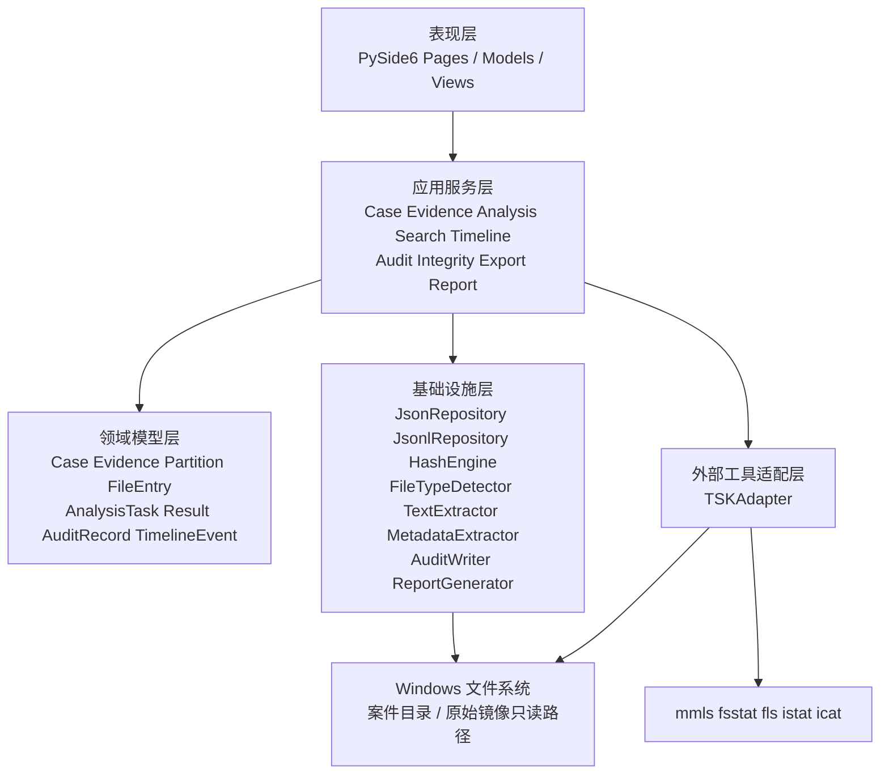
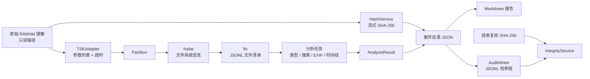

# Relic 分层架构

Relic 是面向课程设计的数字取证与证据完整性分析平台，目标是完成可靠、可复现的核心工作流，不宣称完全替代 Autopsy。

## 分层

## 依赖规则

- UI 只能依赖应用服务接口、领域模型和 Qt Model/View；不得执行 TSK 命令或直接写 JSONL。
- 应用服务编排用例、任务和审计；不得依赖具体 Qt 控件。
- 领域模型不依赖 PySide6、TSK、文件系统或 JSON 库。
- 基础设施实现仓储、哈希、提取和报告接口；不得包含页面逻辑。
- `TSKAdapter` 是唯一允许调用 TSK CLI 的模块。
- 外部命令只接收已经校验的绝对路径、整数偏移和枚举参数。

## 数据流

## 只读与隔离

- 原始镜像路径必须通过 `Path.resolve()` 校验为文件，打开策略是读取，不创建临时文件、不在其父目录写入。
- 案件目录独立于镜像目录，缓存、清单、导出和报告只写入案件目录。
- 软件只读不等同于硬件写保护器；报告必须明确写出这一限制。
- 导出文件重新计算 SHA-256，并记录源证据、导出目标和哈希。

## 并发边界

- 案件元数据 JSON 由应用服务串行提交更新，使用临时文件写入后原子替换。
- 每个 JSONL 文件只能有一个写入者。后台任务通过结果队列交给应用线程追加，禁止多个 worker 同时追加同一文件。
- 读取可使用快照或文件锁；审计写入必须串行并在写入后 flush。
- GUI 线程只负责提交任务和消费进度信号，所有哈希、TSK、遍历、搜索和导出均在 `QThreadPool` 中执行。

